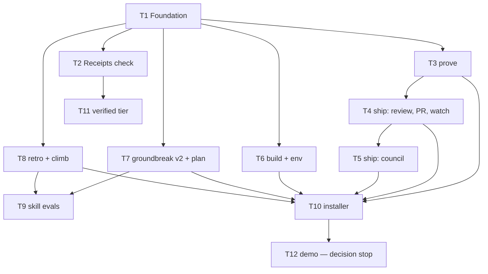

# mitchstack v1 — ticket graph (spec run)

Spec: [mitchstack-v1.md](mitchstack-v1.md) (approved by Isaac 2026-11-04, except branding and the
local-proof hook question). Status: **awaiting gate 1** — Isaac's yes must name this file and its
commit. Run shape: one integration branch `mitchstack/v1` from `origin/main`; ticket worktrees branch
from it; merge commits; at most two implementers at once on disjoint files; one draft PR opened
after the first ticket merges; one integration review at the end; one PR.

Defaults for every ticket unless stated:
- **Designated builder:** Claude Code.
- **Independent reviewers:** the run's single integration review by **Codex** (cross-provider), plus
  a visual reviewer (Claude Code fresh context) where pictures decide.
- **Machine checks:** `npm test` · `npm run typecheck` · `npm run lint` · `git diff --check`
  (established by T1).
- **Required evidence:** red→green reproduction receipt per behavior; measured output pairs for
  non-visual work; persisted under `.artifacts/<ticket>/` (gitignored), posted to the PR after it exists.
- **UI design source:** N/A — no ticket in this graph ships a user interface.

---

## T1 — Foundation: contract, config, license, credits

**The ask.** *Change:* the repo gets its rulebook, its settings file, its license and a credits page,
so every later piece has one place to point. *Could break:* if the settings format is wrong, every
later ticket inherits the mistake. *You'll know I'm wrong:* you read the rulebook and it still sounds
like BuilderWrx, or you can't tell what the two gates are in under a minute.
- **Scope:** `AGENTS.md` (two gates, stop rules, laws, scrubbed of private names); `mitchstack.yaml`
  schema + validator (owner, profile, checks table, visible-change patterns, ownership gates,
  council budget); receipts-block JSON schema; `LICENSE` (MIT); `CREDITS.md`; README skeleton;
  Node/TypeScript tooling with test/typecheck/lint scripts.
- **Out of scope:** any skill text (T3–T8); README voice/branding (defaults to pure software, see
  ledger OPEN).
- **Files:** `AGENTS.md`, `mitchstack.yaml.example`, `schema/`, `src/config/`, `LICENSE`,
  `CREDITS.md`, `README.md`, `package.json`, `tsconfig.json`. Reuse: none (empty repo).
- **Observable:** a sample config with a typo is rejected with a readable message naming the field.
- **Evidence:** validator output pair (valid vs invalid config); grep showing zero private names.

## T2 — Receipts check (present tier)

**The ask.** *Change:* a check on every pull request that fails when a visible change has no
before/after pictures, no merge-danger note, or no proof the fix was shown failing first. *Could
break:* it could block honest PRs (false alarms) and get switched off. *You'll know I'm wrong:* a
backend-only PR gets stuck waiting on the check, or a PR with the same picture twice passes.
- **Scope:** GitHub Action reading the receipts block from the PR body with the read-only token;
  no secrets, no LLM; `pull_request` trigger only; no `paths:` filter; labels "receipts: present,
  not verified"; `no-visible-change: <reason>` escape.
- **Out of scope:** re-running evidence (T11); producing receipts (T3).
- **Files:** `action/receipts/`, `src/receipts/`, `test/fixtures/receipts/`. Reuse: T1 schemas.
- **Observable:** on fixture PRs: honest PR passes; same-image-twice, stale SHA, missing door all fail
  with a reason; docs-only PR passes without pending.
- **Evidence:** fixture matrix output; one real run of the Action on the draft integration PR.

## T3 — `prove` skill + capture

**The ask.** *Change:* the agent produces the before/after pictures, the try-it-yourself steps and the
receipts block for every change, the same way every time. *Could break:* flaky pictures that differ
for reasons unrelated to the change. *You'll know I'm wrong:* two captures of an unchanged page come
out different.
- **Scope:** `skills/prove/SKILL.md` (own words); deterministic Playwright capture script (fixed
  viewport, animations off, frozen clock, masks); receipts-block writer; `before: absent` support.
- **Out of scope:** PR opening and review (T4).
- **Files:** `skills/prove/`, `src/capture/`. Reuse: T1 receipts schema; Playwright.
- **Observable:** capturing an unchanged fixture page twice yields identical hashes.
- **Evidence:** hash pair for unchanged page; before/after pair for a deliberately changed fixture.

## T4 — `ship` skill: review loop, PR body, watcher, full-stop

**The ask.** *Change:* before asking you to open a PR, the agent gets a reviewer from another AI
company to check its work, then writes the PR the same way every time and watches it until it's
ready for you. *Could break:* review loops that never end or approve by timing out. *You'll know I'm
wrong:* a PR reaches you saying "approved" when the reviewer never actually answered.
- **Scope:** `skills/ship/SKILL.md`: review loop (ids, blocker/should/nit, 3/5 rounds, verdict format,
  timeout ≠ approval, Open disputes); reviewer discovery (`delegate_task`, `codex exec`,
  `claude -p`, `cursor-agent`, solo same-provider label); PR body template; `gh --attach` with
  artifacts fallback; one watcher per PR; full-stop ending.
- **Out of scope:** council (T5).
- **Files:** `skills/ship/`, `src/review/`, `src/watch/`, `templates/pr-body.md`. Reuse: T3 receipts.
- **Observable:** a simulated reviewer that times out yields "not approved" in the ledger and PR body.
- **Evidence:** ledger outputs for approve / changes / timeout / dispute cases.

## T5 — `ship` council with drift control

**The ask.** *Change:* for visible changes in the full-factory setting, three AI companies score the
before/after pictures out of 10, with a control picture that catches judges drifting. *Could break:*
cost — three paid models per round. *You'll know I'm wrong:* the score table shows numbers on a round
where the control picture's score jumped.
- **Scope:** council runner (cheapest judge first, hidden target, randomized order, median of 3);
  control tolerance band from baseline scorings; rescore only on visible-file change; per-PR budget
  cap → "no council"; score table in PR body.
- **Out of scope:** using scores as a merge gate.
- **Files:** `src/council/`, `skills/ship/council.md`. Reuse: T4 reviewer discovery.
- **Observable:** a planted drifting judge gets its round discarded.
- **Evidence:** run log with a planted-drift round discarded; cost per round measured.

## T6 — `build` skill + `mitchstack env`

**The ask.** *Change:* every task starts in its own copy of the code with its own ports and database,
and the agent builds from a short, structured brief, showing the problem before fixing it. *Could
break:* two copies grabbing the same port and one silently testing the other's app. *You'll know I'm
wrong:* two tasks running at once and one of them shows you the other's screen.
- **Scope:** `skills/build/SKILL.md` (isolate, brief, one builder, repro-first, stop rules, spec runs);
  `mitchstack env` (ports, env files, deps, DB branch/schema hook, port-ownership check).
- **Out of scope:** provisioning any specific database product.
- **Files:** `skills/build/`, `src/env/`, `bin/mitchstack`. Reuse: T1 config.
- **Observable:** two worktrees get distinct ports; the ownership check rejects a foreign process.
- **Evidence:** output pair from two worktrees; planted foreign-process rejection.

## T7 — `groundbreak` v2 + `plan`

**The ask.** *Change:* the brainstorming skill gets the hunt, the board, launch-post-first and the
better question filter, and planning becomes one skill that turns decisions into a spec and tickets.
*Could break:* the skills get longer and slower, the opposite of what you asked. *You'll know I'm
wrong:* a settled small task still drags you through the full brainstorm.
- **Scope:** `skills/groundbreak/` (8 phases, express lane = grill, hunt with multi-provider channels
  and research doc, board bench, separation-based fights, 10x test, domain-native steals);
  `skills/plan/` (spec with seams first, tracer-bullet tickets, decision classes, ticket template).
- **Out of scope:** the eval harness (T9).
- **Files:** `skills/groundbreak/`, `skills/plan/`, `templates/ticket.md`.
- **Observable:** both skills load in Claude Code and Codex; express lane triggers on a settled ticket.
- **Evidence:** a transcript of each lane on a sample subject.

## T8 — `retro` + `climb`

**The ask.** *Change:* a retro you can ask for that turns your picks into tickets, and a hill-climb
mode that plans its steps and keeps only changes that measurably help. *Could break:* the climb
"improves" by noise. *You'll know I'm wrong:* a kept change that does nothing on a re-run.
- **Scope:** `skills/retro/` (categories, Accepted/Rejected/Backlog, picks → `gh issue create` only
  after Isaac picks); `skills/climb/` (ladder, frozen harness, median of N, `decision.tsv`,
  keep/revert, never relax target).
- **Files:** `skills/retro/`, `skills/climb/`, `src/climb/`.
- **Observable:** a planted no-op change is reverted by the climb.
- **Evidence:** `decision.tsv` showing the planted no-op reverted.

## T9 — Skill eval harness + baselines

**The ask.** *Change:* each skill gets test scenarios with a score, so "mitchstack improves itself"
becomes something we measure. *Could break:* scores that reward the wrong thing. *You'll know I'm
wrong:* a skill edit you think is worse scores higher.
- **Scope:** eval format, runner (council-scored with control), baseline committed per skill; this
  session as groundbreak eval #1 (scrubbed).
- **Files:** `evals/`, `src/evals/`. Reuse: T5 council, T8 climb.
- **Evidence:** baseline scores committed; a deliberately degraded skill scores lower.

## T10 — Installer + plugin manifest

**The ask.** *Change:* one install command puts mitchstack into Claude Code, Codex and Cursor.
*Could break:* overwriting skills someone already has. *You'll know I'm wrong:* after installing,
one of your existing skills is gone or changed.
- **Scope:** `npx skills add` compatibility, Claude plugin manifest, `AGENTS.md` generation for
  Codex/Cursor, hooks + git pre-push equivalent; never touches another host's install; idempotent.
- **Files:** `src/install/`, `.claude-plugin/`, `hooks/`.
- **Evidence:** install into a temporary home for each host; file listing before/after; re-install
  diff is empty.

## T11 — Receipts check, verified tier

**The ask.** *Change:* an optional stricter check that re-runs the proof itself instead of trusting
the agent's word. *Could break:* slow or flaky CI. *You'll know I'm wrong:* an honest PR fails the
verified check for reasons unrelated to the change.
- **Scope:** re-run claimed test at base+new test (must fail) and head (must pass); re-capture via
  the repo's Playwright script at base and head.
- **Files:** `action/receipts/verified/`, `src/receipts/verify/`. Reuse: T2, T3.
- **Evidence:** fixture repo where a faked red→green is caught.

## T12 — Demo — **decision stop**

Content depends on what the kit looks like after T10 and on the branding decision. The run pauses
here and asks once. Must be a headless capture, never desktop recording.

---

## Before asking for the yes
- [x] Every field filled or defaulted above.
- [x] Facts checked against the current repo (`origin/main` = `8a453e7`, empty).
- [x] No UI in this graph; design source N/A.
- [x] No build code written.
